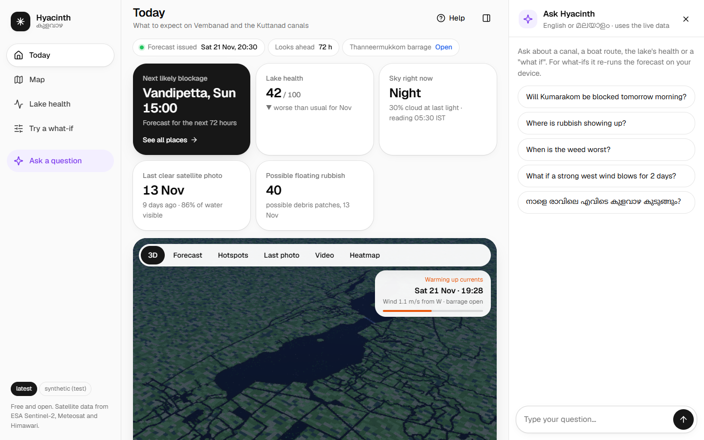
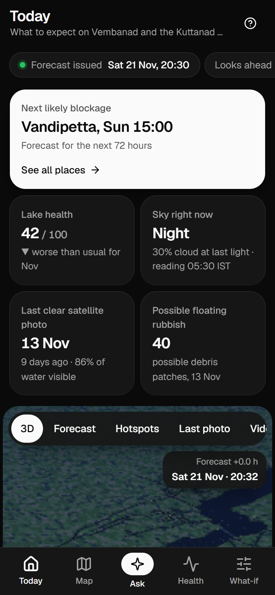
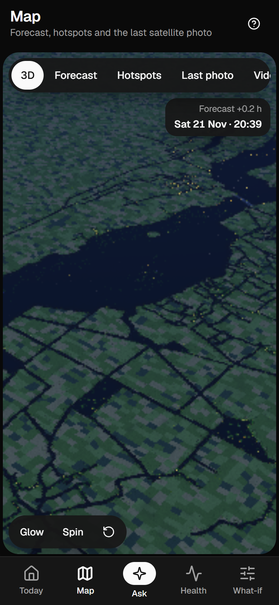
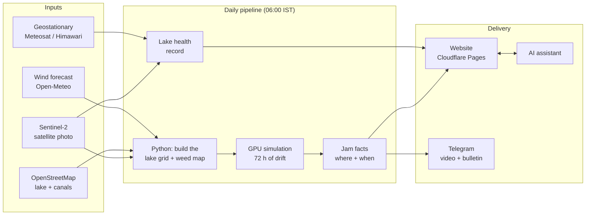

<div align="center">

# Hyacinth · കുളവാഴ

**A free, daily forecast of where water hyacinth will choke Kerala's backwaters, 72 hours before it happens.**

A GPU fluid simulation of Vembanad Lake, seeded from satellite photos, running live in your browser.<br>
Plus a satellite-based lake health record and an AI assistant that answers in English and Malayalam.

[**Live site**](https://hyacinth-574.pages.dev) · [**Telegram channel**](https://t.me/hyacinth_forecast) · [How it works](#how-it-works) · [Run it yourself](#run-it-yourself)




</div>

---

## The problem

Water hyacinth (*kulavazha*, കുളവാഴ) is a floating weed that covers huge stretches of
**Vembanad Lake** and the **Kuttanad** canal network in Kerala. It drifts with the wind and the
current, then piles up against banks, bends and the Thanneermukkom barrage. When it locks in, it
blocks boats, ferries and houseboats, cuts off fishing grounds and clogs irrigation for days.

The mats move every day, and nobody knows where they will pile up next. Clearance crews tend to
arrive after a canal is already blocked.

## What Hyacinth does

| | |
|---|---|
| 🗺️ **Forecasts jams 72 h ahead** | Every morning it takes the latest clear satellite photo of the weed, simulates how the water and wind will move it, and lists the places likely to block and *when* (e.g. "Vandipetta, Sunday 15:00"). |
| 🖥️ **Runs the simulation in your browser** | The same physics engine that makes the daily forecast runs live on your GPU. Tap the water to drop weed and watch where it drifts; change the wind or open the barrage and see what happens. |
| 🛰️ **Tracks the lake's health** | A record of every clear Sentinel-2 pass since January 2025: weed cover, possible floating rubbish, algae and muddiness for 84 zones of the lake, with trends, seasons and worst-zone rankings. |
| ☁️ **Knows the sky right now** | Geostationary weather satellites (Meteosat, Himawari) watch the lake every 15 minutes, filling the days between sharp satellite photos and explaining monsoon gaps. |
| 💬 **Answers questions** | *"Will Kumarakom be blocked tomorrow morning?"* · *"What if the barrage closes for two days?"* The AI assistant reads the forecast and satellite record, runs what-if simulations on your device, and points at places on the map. English or Malayalam. |
| 📣 **Reaches people where they are** | A daily bilingual bulletin with a forecast video goes to a public Telegram channel, ready to forward into WhatsApp groups. |

**Who it's for:** clearance crews and panchayats deciding where to send people and harvesters;
boat, ferry and houseboat operators choosing routes; irrigation staff weighing what the barrage
does; researchers and officials watching the lake over time.

> [!IMPORTANT]
> Hyacinth forecasts a **likelihood**, not a certainty. The simulation is not calibrated against
> measured drift, and satellites can't see through cloud. The site always says how old its data is.

<div align="center">


</div>

---

## How it works



### 1. Seeing the weed from space

Every few days, ESA's **Sentinel-2** satellites photograph the lake at 10 m detail in bands
including near-infrared. Living plants reflect near-infrared strongly and water absorbs it, so
floating hyacinth stands out clearly from open water (NDVI > 0.45). Hyacinth uses the newest
photo with at least 70% of the water cloud-free, ignores pixels touching a bank (where palms and
paddy would fool it), and records how much of each 40 m cell of the lake is covered.

### 2. Simulating the water

The lake becomes a grid of **746 × 1054 cells, each 40 m across**, built from OpenStreetMap's
water and canal outlines, with the river inflows, the sea outlet towards Kochi and the
Thanneermukkom barrage marked in.

On that grid, a **lattice-Boltzmann** fluid solver works out how the water moves: wind pushes the
surface, the lake bed drags it back, rivers push in, and the barrage blocks or passes flow.
It's written in WGSL compute shaders and runs on the GPU, so a full 72-hour forecast takes
seconds to minutes instead of hours.

### 3. Moving the weed

Each patch of weed becomes thousands of particles. They ride the current, catch about **3% of the
wind** like a sail, slow down when crowded, clump into rafts and stick when they hit a bank. A
place counts as **jammed** once weed has piled up at blocking density near a bank, bend, inlet or
the barrage for two hours, and the time that happens is its forecast **ETA**.

### 4. Turning it into answers

The pipeline turns the jam map into plain facts: *which named places, how many hectares, by what
time*, using OpenStreetMap place and canal names. Those facts become the daily bulletin (written by
AI in Malayalam and English, never allowed to invent names), the website's timeline, and the
Telegram post.

### 5. Watching the lake's health over time

Separately, every clear Sentinel-2 pass since January 2025 is analysed for 84 zones of the lake:

| Indicator | How it's measured | What it tells you |
|---|---|---|
| **Weed cover** | NDVI > 0.45 on open water | % of the water covered by floating hyacinth |
| **Possible rubbish** | Floating Debris Index (Biermann et al. 2020) above that pass's own open-water level | low confidence on one pass; spots seen again and again matter |
| **Algae** | NDCI | chlorophyll-a proxy, i.e. algal growth |
| **Muddiness** | NDTI | sediment / turbidity proxy |
| **Health index (0–100)** | average percentile rank of the four, against each zone's own history | 100 = the best this zone has been; relative, not a legal standard |

Geostationary satellites add a cloudiness and sunshine reading **every day** (every 15 minutes
from orbit), so you can see the monsoon months where clear photos run out, and a "sky right now"
reading only minutes old.

### 6. The AI assistant

The assistant (OpenAI, model set by `OPENAI_MODEL`) doesn't make up numbers. It **calls tools that
run in your browser** against the real data:

| Tool | What it does |
|---|---|
| `run_scenario` | Re-runs the forecast live on your GPU with a different wind or barrage setting and compares jams place by place |
| `show_place` | Flies the 3D camera to a place and drops a pin |
| `lake_health`, `metric_series`, `rank_zones` | Reads the satellite health record: a date, a trend, the worst zones |
| `debris_sightings` | Lists possible rubbish patches and which ones keep coming back |
| `sky_now` | Reads the latest geostationary cloud and sunshine |
| `show_map_layer` | Switches the map to hotspots, the last photo or the forecast |

The server is stateless: the browser holds the conversation, and each request is validated before
it reaches the model.

---

## Engineering highlights

- **One physics engine, two homes.** The simulation is written once in WGSL (`sim/shaders/`) with
  one TypeScript driver (`sim/engine.ts`). It runs in the browser via WebGPU and headless in Deno
  for the daily render, so what you play with *is* the forecast model.
- **Only computes where there's water.** The solver dispatches only the 8 × 8 tiles that contain
  water (about a third of the grid), packs each cell's neighbour walls into one bitmask, and
  encodes a whole batch of steps as a single compute pass.
- **Smooth on any GPU.** A frame pacer keeps at most two frames in flight and sizes the number of
  simulation steps per frame from measured GPU time. A slower GPU simulates fewer hours per second
  instead of stuttering. On a laptop RTX 3050 a step takes about 0.57 ms, roughly 3 simulated
  hours per real second.
- **Instant start.** The daily render saves the weed's state at forecast start; the browser loads
  it and only warms up the currents, instead of replaying days of spin-up. Resets and what-ifs
  restore a GPU-side checkpoint with no CPU round trip.
- **Tested physics.** `deno task selftest` checks the solver on the GPU against known answers: rest
  state, mass conservation, wind-driven current (about 2% of wind speed), weed drift (current + 3%
  windage), the barrage closed vs open, pile-up against a bank, and river-driven flow.
- **Light front end.** No framework: plain TypeScript and CSS, a hash router, about 50 KB of
  gzipped JS. The map pauses when it's off screen.
- **Works for everyone.** Big touch targets, plain-language labels, bilingual text, light and dark
  themes, reduced-motion support, a phone layout with a bottom tab bar and an assistant sheet.

---

## Run it yourself

### Requirements

- Python 3.11+, Node 20+, Deno 2.x
- A GPU with WebGPU support (any recent Chrome/Edge; Mesa lavapipe works headless on CI)
- ffmpeg on `PATH` for the forecast video (optional)

### Setup

```sh
python -m venv .venv && .venv/Scripts/pip install -r pipeline/requirements.txt   # bin/ on Linux/macOS
cd web && npm install && cd ..
cp .env.example .env        # then fill in your keys (see Configuration)
deno task selftest          # GPU physics checks
```

### Try it offline (synthetic lake)

```sh
cd pipeline
python -m hyacinth synth                       # build a synthetic test lake -> data/synthetic
python -m hyacinth render ../data/synthetic    # 72 h run: video, heatmap, jam/ETA maps
python -m hyacinth caption ../data/synthetic --no-model
python -m hyacinth publish ../data/synthetic synthetic
cd ../web && npm run dev                       # http://localhost:5173
```

### The real lake

```sh
cd pipeline
python -m hyacinth daily        # everything below, in order
```

| Command | What it does |
|---|---|
| `fetch` | Builds the lake grid from OSM (cached), finds the newest clear Sentinel-2 photo, downloads the wind |
| `render <dir>` | Runs the 72 h GPU simulation headless: video, heatmap, jam and ETA maps, forecast facts |
| `caption <dir>` | Writes the bilingual bulletin (AI if configured, otherwise a template) |
| `publish <dir> <name>` | Copies a run into the website's data folder |
| `post <dir>` | Posts the video, heatmap and bulletin to Telegram |
| `health` | Adds new clear Sentinel-2 passes to the lake-health record (the first run backfills from Jan 2025) |
| `health-publish` | Writes the health dataset, hotspot map and last-pass map for the website |
| `hindcast-dates`, `hindcast`, `score` | Back-test: start from a past photo, run with the real past wind, and score the result against a photo 5 days later |

### Configuration

All keys live in `.env` (copy `.env.example`). Nothing is required to run offline.

| Variable | Used for |
|---|---|
| `OPENAI_API_KEY`, `OPENAI_MODEL` | AI assistant and AI-written bulletin (e.g. `gpt-6-luna`) |
| `TELEGRAM_BOT_TOKEN`, `TELEGRAM_CHAT_ID` | Daily Telegram post (`@your_channel`; the bot must be a channel admin) |
| `HYACINTH_SITE_URL` | Link added to each Telegram post |
| `HYACINTH_BARRAGE` | Force the barrage `open` or `closed` (otherwise seasonal: closed mid-Dec to March) |
| `CLOUDFLARE_API_TOKEN`, `CLOUDFLARE_ACCOUNT_ID` | Deploying the site from CI |

Model knobs live in `pipeline/hyacinth/config.py` (area, grid, barrage line, detection
thresholds) and `DEFAULT_PARAMS` in `sim/engine.ts` (physics).

### Deploy

- **Website:** `cd web && npm run build`, then `wrangler pages deploy dist --project-name=hyacinth`.
  The AI endpoint is a Cloudflare Pages Function (`web/functions/api/ask.ts`); set
  `OPENAI_API_KEY` and `OPENAI_MODEL` as secrets on the Pages project.
- **Daily job:** `.github/workflows/daily.yml` runs at 06:00 IST on GitHub Actions with a software
  GPU, then forecasts, writes the bulletin, updates lake health, deploys and posts. Add the
  variables above as repository secrets and variables. Any machine with a GPU can run
  `python -m hyacinth daily` on a cron instead.

---

## Project layout

```
sim/            the physics: WGSL shaders + the TypeScript engine shared by browser and Deno
render/         headless Deno runners: daily render, GPU self-tests, benchmark, 3D stills
pipeline/       Python: satellite + OSM + wind ingest, lake health, captions, Telegram, publishing
web/            the website (Vite + TypeScript + WebGPU)
  src/          app shell, 3D lake, assistant client, health dashboard, frame pacer
  server/       the AI endpoint (shared by dev server and Cloudflare)
  functions/    Cloudflare Pages Function wrapper
.github/        the daily workflow
```

### Data contract

Each run is three plain files, so any part can be swapped out:

| File | Content |
|---|---|
| `mask.png` | One pixel per cell, north up: black land, white water, green river inflow, blue sea outlet, red barrage |
| `seed.png` | Greyscale: fraction of each cell covered by weed (0–255) |
| `wind.json` | Hourly wind from the satellite pass through the 72 h window, plus grid spacing and barrage state |

The simulation starts at the satellite photo's time and "catches up" to now with the observed
wind, so the forecast begins from where the weed actually is today.

---

## Honest limits

- **Uncalibrated.** The physics is plausible and self-tested, but not fitted to measured drift.
  It's a likelihood map, not hydrology. It's a 2D model, not full shallow-water equations.
- **Clouds.** Sentinel-2 can't see through cloud, so in the monsoon the newest clear photo can be
  weeks old. Radar (Sentinel-1) would fix this and isn't built yet.
- **Narrow canals.** Canals under about 20 m wide can't be seen at 10 m resolution, and the
  simulation widens small canals to 80 m so water can flow. The health record leaves narrow
  canals out entirely.
- **Rubbish detection is low confidence.** At 20 m, small young hyacinth clumps can look like
  floating debris. Spots seen on several passes are far more trustworthy than one-offs.
- **One wind for the whole lake.** The wind comes from a single forecast point.
- **The barrage isn't the only gate.** Kuttanad has many smaller regulators that aren't modelled.

---

## Data and credits

- Copernicus **Sentinel-2** (ESA), via the Microsoft Planetary Computer
- **EUMETSAT Meteosat** (IODC) and **JMA Himawari** surface radiation, wind and weather via [Open-Meteo](https://open-meteo.com) (CC BY 4.0)
- Map data © **OpenStreetMap** contributors (ODbL)
- Floating Debris Index: Biermann, L. et al. (2020), *Finding Plastic Patches in Coastal Waters using Optical Satellite Data*, Scientific Reports 10, 5364

Built for the Alappuzha Challenge (Place & People).
